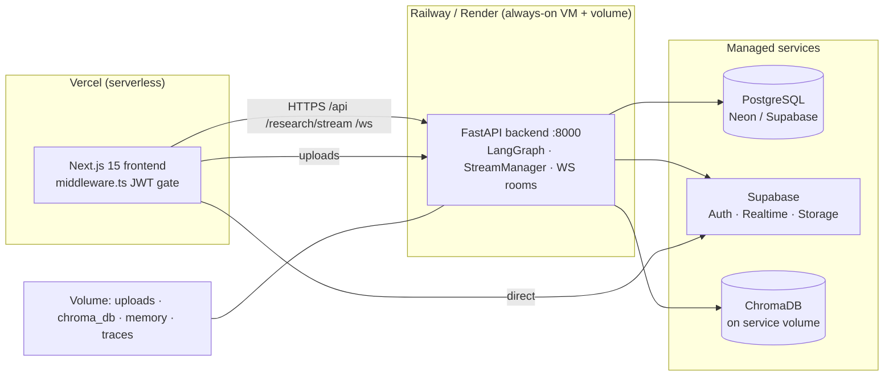

# ResearchSwarm — Production-Readiness Audit (Vercel)

**Date:** 2026-08-10 · **Mode:** read-only audit + build/test verification (no code modified, nothing deployed)
**Verified:** `tsc --noEmit` ✅ · next build ✅ · vitest 62/62 ✅ · pytest 190/190 ✅

---

## 0. Executive Summary

The frontend is mature and builds cleanly, but **this project is not one click away from Vercel production**. Three deployment blockers (P0), eight serious issues (P1), and a key architectural fact:

> **The backend cannot run on Vercel.** It is a stateful, single-process service (in-memory stream queues, WebSocket rooms, rate-limit buckets, LangGraph `MemorySaver`, magic-link store) with mandatory local disk (SQLite, ChromaDB, uploads, memory, traces). Deploying it as serverless functions would require a rewrite: external queue (Redis), Postgres-only, S3/R2 object storage, stateless agents, distributed rate limiting.

**Recommended model (Option B):** Frontend on **Vercel** + backend as an **always-on service** (Railway — `railway.toml` already exists, or Render — `render.yaml` exists) + **hosted Postgres** + **Supabase-hosted or Neon** for the persistence layer. This matches the existing repo intent.

**Biggest hidden landmine found and verified:** the production bundle built locally bakes `http://localhost:8000` into client JS (because `.env.production` sets `NEXT_PUBLIC_API_URL=""`, and every consumer falls back with `|| "http://localhost:8000"`). Verified in `.next/static/chunks/*` after a clean `npm run build`.

---

## 1. Findings

Legend: **P0** = deployment blocker · **P1** = serious production issue · **P2** = recommended · **P3** = polish

### P0 — Deployment blockers

| # | File | Line | Problem | Production impact | Fix |
|---|---|---|---|---|---|
| 1 | `frontend/.env.production` + `frontend/lib/api-client.ts`, `lib/websocket.ts`, `components/Settings.tsx`, `app/app/layout.tsx`, `app/onboarding/page.tsx` | `.env.production:2`; `api-client.ts:94`; `websocket.ts:1`; `Settings.tsx:10`; `layout.tsx:7`; `onboarding/page.tsx:12` | `NEXT_PUBLIC_API_URL=""` (empty) plus `|| "http://localhost:8000"` fallback in 5 code sites. **Verified:** built chunks contain `localhost:8000` | Every API/SSE/WS request goes to the visitor's own machine. App is dead on Vercel unless the env var is set in the dashboard — and silently looks "healthy" in dev | Set `NEXT_PUBLIC_API_URL` on Vercel (required); replace `|| "http://localhost:8000"` with a fail-fast throw/empty-state so misconfiguration is loud; delete stale local `.env.production` (also contains a live `VERCEL_OIDC_TOKEN` JWT) |
| 2 | `frontend/lib/supabase/client.ts`, `frontend/.env.local` | `client.ts:4-5`; `.env.local:1-2` | Supabase client uses non-null-asserted envs with **no fallback**; the only config in-repo points at `http://127.0.0.1:54321` (local Supabase CLI) | Workspace live queries, realtime channels, and `/app/reports/[id]` all depend on Supabase. On Vercel without prod Supabase envs, `createClient()` throws / reports page renders blank | Provision a production Supabase project (or Neon for Postgres + keep Supabase for realtime/storage); set `NEXT_PUBLIC_SUPABASE_URL` + `NEXT_PUBLIC_SUPABASE_ANON_KEY` on Vercel; backend needs `SUPABASE_SERVICE_ROLE_KEY` + `SUPABASE_BRIDGE_SECRET` |
| 3 | `backend/` (entire service) | see §2 | Stateful + disk-bound backend, in-memory streams/WS/rate-limit, synchronous graph runs with 30–60s provider calls | Cannot be hosted as Vercel Functions without a rewrite. Would break: streaming, WS rooms, MagicSaver checkpoints, Chroma, uploads, rate limiting, magic links | Deploy backend as persistent service (Railway/Render/Dokploy). Vercel hosts only the Next.js frontend. See §4, §6 |
| 4 | `backend/api/main.py` + `frontend/lib/api-client.ts` | `main.py:1221-1245`; `api-client.ts:619-621`; `PDFUploader.tsx:249-255` | `/documents/{id}/download` requires `get_current_user` (Bearer/API-key). Frontend opens the raw URL in a **new tab** — no Authorization header can be attached; the API cookie is never set (JS-written cookie belongs to the frontend origin) | PDF downloads 401 in production | Add short-lived signed download URLs (HMAC `?expires=&sig=`) or set a domain-scoped HttpOnly cookie on the API host from login |

### P1 — Serious production issues

| # | File | Line | Problem | Impact | Fix |
|---|---|---|---|---|---|
| 5 | `frontend/lib/auth.tsx`, `lib/api-client.ts`, `frontend/middleware.ts` | `auth.tsx:42-84`; `api-client.ts:100-129`; `middleware.ts:39-44` | JWT access + refresh tokens in `localStorage`; duplicated to a **non-HttpOnly** cookie so middleware can read it (XSS token theft; cookie not bound to API origin) | Any XSS steals a 30-min access + 7-day refresh token pair. Middleware also can't verify signature, and the cookie is URI-encoded but decoded with `atob` (`middleware.ts:44`) — token can fail validation on special chars | Medium term: HttpOnly `SameSite=Strict` cookie set by the API on the API domain; keep localStorage as interim but add a strict Content-Security-Policy |
| 6 | `backend/api/main.py` | `main.py:1410-1435` | `/billing/usage` uses `organization_id` from the **query param**, not `ctx.organization_id` | Cross-org read (IDOR) of usage sums | Use tenant context only |
| 7 | `backend/api/main.py` | `main.py:1718-1747` | `/plugins/{name}/configure` + `/execute` mutate global in-memory config and forward **arbitrary JSON** to plugins (GitHub token-scope access, arbitrary hosts) | Any authenticated user can reconfigure shared plugin state / trigger actions with attacker-supplied kwargs | Admin-only + per-tenant config; validate/allowlist action kwargs |
| 8 | `backend/tools/browser.py`, `backend/tools/code_executor.py`, `backend/agents/research_agent.py` | `browser.py:26-115`; `code_executor.py:17-147`; `research_agent.py:38-96` | Registered but not graph-wired tools: `read_page`/`extract_links` accept arbitrary URLs (**SSRF**: `file://`, metadata IPs, internal services, `follow_redirects=True`); `execute_python`/`execute_shell` run with a static blocklist, not a sandbox | If ever wired to an agent or exposed via plugins, remote code execution + SSRF from public endpoints | Restrict schemes to http/https, block RFC1918/link-local/metadata IPs, deny redirects to those; remove or gate code exec behind an admin flag |
| 9 | `backend/api/main.py` | `main.py:1008-1069` | Upload size enforced only via `Content-Length` header; full body read into RAM; **no antivirus** | Chunked/streamed bodies bypass the 50 MB cap; malicious PDFs land on disk and are parsed later | Stream-read with a hard byte cap (e.g., `request.stream()` + counter); add extension+MIME allowlist (already `%PDF` magic-byte ✅); AV scan if budget allows |
| 10 | `backend/llm/openrouter_provider.py`, `backend/llm/ollama_provider.py` | `openrouter_provider.py:33` (timeout 60s) | No retry/backoff on LLM calls (`tenacity` present in `requirements.txt` but unused); no 429/5xx/`ResourceExhausted` handling; single fixed timeout | Provider hiccup → 60s stall → possible "Researching…" stuck state; partial/empty responses delivered unguarded | Add per-provider retry w/ backoff (429 + 5xx), per-request timeout, empty/malformed-response fallback; guarantee terminal state (success/cancelled/failed) in the client |
| 11 | `frontend/.env.production`, `frontend/.env.vercel` | `:21` / `:2` | Contain a **live `VERCEL_OIDC_TOKEN` JWT**; `frontend/Dockerfile:12` does `COPY . .` and there is **no `frontend/.dockerignore`** | Env files (incl. tokens) copied into Docker images | Add `frontend/.dockerignore` (`.env*`, `.next`); delete stale local env artifacts after pulling Vercel envs |
| 12 | `backend/api/auth.py`, `backend/auth/providers.py` | `providers.py:19-39`; `auth.py:391-515` | Google/GitHub/Microsoft OAuth redirect URIs **hardcode `localhost`** | Social login breaks in production until made env-driven | Read redirect URIs from env (`GOOGLE_REDIRECT_URI`, etc.); provision URIs in the OAuth consoles |
| 13 | `backend/api/auth.py` | `auth.py:529-541`, `auth.py:582` | Password reset + magic links **send no email** — links are logged (dev) or stored in an in-memory dict; `/forgot-password` returns a generic message with no delivery | Users can't recover accounts in production | Integrate an email provider (Resend/SES) or disable the flows with a clear message until wired |
| 14 | `backend/api/main.py`, `backend/api/metrics.py` | `main.py:349` (`/debug/db`), `metrics.py` | Unauthenticated `/debug/db` dumps `information_schema` column data; `/metrics` public; `/models` proxies OpenRouter with the server Bearer key | Schema/stack info disclosure; needless attack surface | Require auth or remove `/debug/db`; keep `/health`+`/ready` public only |
| 15 | `backend/core/supabase.py` | `:130` | `ensure_supabase_user` scans only the **first 100** users returned by the Supabase auth API | Users beyond page 1 get duplicate bridged accounts on every login | Paginate the user listing |

### P2 — Recommended

| # | File | Line | Finding |
|---|---|---|---|
| 16 | `backend/core/ratelimit.py` | `:18-21` | Rate limits are **per-process + IP-based**; multi-instance deployments multiply limits; no per-user buckets. Move to Redis when scaling out |
| 17 | `backend/api/main.py` | `main.py:1521-1534`, `main.py:1442-1514` | Role-permission checks missing on `/audit-logs` (`view_audit_logs`) and `/api-keys` (`manage_api_keys`) — any member may list/revoke keys |
| 18 | `backend/api/auth.py` | `auth.py:186-210` | MFA exists (setup/verify) but `/login` never enforces it when `mfa_enabled` |
| 19 | `docker-compose.yml` | `:6-10`, `:25-26`, `:58` | Postgres (`swarm/swarm`) and Ollama published to `0.0.0.0` with no auth; `JWT_SECRET_KEY` unset falls back to a derived dev key. Dev-only posture — bind `127.0.0.1`, require strong creds if shared |
| 20 | `backend/api/main.py`, `backend/auth/` | `main.py:1786-1791` | Custom-provider secrets stored **plaintext in the DB** at rest |
| 21 | `backend/search/providers/search.py` | `:166` | Fallback DDG scraper uses `httpx.Client(verify=False)` — TLS verification disabled on the degraded path |
| 22 | `backend/agents/document_agent.py`, `backend/tools/search.py` | `document_agent.py:100`; `search.py:33,49,62` | `asyncio.run()` inside sync tool paths — works on threads today, breaks in event-loop-constrained runtimes; prefer `asyncio.get_event_loop().run_in_executor` or async-native nodes |
| 23 | `backend/api/main.py` | `main.py:248-256` | CORS default mixes `localhost` + one Vercel origin; `allow_credentials=True` — validate `CORS_ORIGINS` at boot and reject `*` |
| 24 | `backend/api/stream.py` | `:28-34` | `threading.Queue(maxsize=500)` **silently drops** events on overflow during LLM bursts; agent log lines can vanish from the timeline |
| 25 | `frontend/lib/api-client.ts` | `:416-426` | SSE token captured at subscribe; a 401-refresh mid-stream leaves a stale-token connection; no SSE reconnect (only WS has 3 retries, fixed 5s, no keepalive/visibility handling) |
| 26 | `frontend/app/app/reports/[id]/page.tsx` | via `lib/supabase/query.ts:168-178` | Saved-report page reads Supabase directly with the **client-side** session cookie (`sb-*-auth-token`); if the bridge session expires, page silently renders nothing |
| 27 | `frontend/middleware.ts` | `:41-44` | Cookie value written with `encodeURIComponent`, read without `decodeURIComponent` — JWT chars `+`/`=` can break middleware validation |
| 28 | `frontend/lib/trust-scores.ts` | `:124` | Loads favicons from `https://www.google.com/s2/favicons` — external runtime dependency + leaks researched domains to Google |
| 29 | `frontend/lib/export-report.ts` | `:235-249` | PDF export = `window.open` + `win.print()` — popup blockers degrade it; fine client-side, just flag in docs |
| 30 | `frontend/Dockerfile` | `:6`, `:12-13` | `npm ci --only=production` then `npm run build` → build stage lacks devDeps (typescript/tailwind); Docker path will fail. (Vercel path unaffected — still fix the Dockerfile or drop it) |

### P3 — Polish

- `Chat.tsx:70-82,141-148,633-635`, `Sidebar.tsx:59`, `ReportsPanel.tsx:17`, `WorkflowOverview.tsx:17` — `new Date()`/`Date.now()` in render → hydration mismatch warnings. Move to effects or `suppressHydrationWarning`.
- No `app/global-error.tsx`, no `app/not-found.tsx`, no per-route `loading.tsx` for `/login`/`/onboarding`.
- `react-resizable-panels` declared but never imported (dead weight).
- Dual lockfiles (`package-lock.json` + `pnpm-lock.yaml`) both tracked; `vercel.json` pins `npm install` — consistent but delete the unused one.
- `/app/app/layout.tsx:58` and `tenant.tsx:79,98,110` swallow init errors with `console.warn` — add visible retry surface.
- Theme code dead: hand-rolled `research-swarm-theme` bootstrap vs `forcedTheme="dark"` (`providers.tsx:14-20`) — `ThemeToggle` is a no-op.
- `backend/auth/api` — cosmetic `print()` at `auth.py:86`; README documents `/research` auth as "Optional" (it's required).
- `middleware.ts:46` prefix match (`/app` matches `/apples`) — cosmetic.

### Verified strengths (no action)

- ✅ All `.env*` files gitignored (`backend/.env`, `frontend/.env.local`, `.env.production`, `.env.vercel` all `git check-ignore` — can't be committed by accident)
- ✅ No hardcoded keys in `backend/**/*.py` (only test fixtures)
- ✅ Tenant guards `require_org*` enforce path-org == canonical tenant (kills the main IDOR class)
- ✅ Refresh-token rotation + replay detection (`auth.py:239-254`), OAuth `state` cookie CSRF, `SameSite=Lax/Strict` patterns
- ✅ No open redirect; OAuth popup verifies `origin`
- ✅ PDF: `%PDF` magic-byte + name check, random-prefixed filenames, `os.path.basename` scrub, path-traversal guard in storage provider
- ✅ No SQLi (ORM/SQLAlchemy everywhere), no `dangerouslySetInnerHTML`, report markdown escaped
- ✅ `reactStrictMode`, ESLint/TS strict, CI lints both stacks, 252 tests green
- ✅ SSE disconnect → cancellation with hard 5s shield timeout (`main.py:779-808`); stream owner enforcement (`main.py:721-723`)

---

## 2. Vercel Compatibility Matrix

| Component | On Vercel? | Why / Where it goes |
|---|---|---|
| Next.js frontend | ✅ Yes | Standard Vercel project (already configured: `.vercel/repo.json`, `frontend/vercel.json`), `npm run build` |
| Route handlers / middleware | ✅ Yes | `middleware.ts` runs on Vercel Edge — **but** it only decodes JWT without crypto; acceptable for gating UX, not security |
| `backend/` FastAPI | ❌ No | Stateful/disk-bound (see §0). Deploy to Railway/Render as a service |
| SSE research streaming | ❌ No (on Vercel) | Vercel Functions don't hold stateful server-push (betas exist but the code assumes one long-lived process). Backend service hosts SSE |
| WebSockets (`/ws/workspace/{id}`) | ❌ No | In-memory `WorkingRoom` per process; needs always-on host. (Vercel WS beta would still break: room state is in-process) |
| Long research runs (30–60s+ LLM calls) | ❌ No | Synchronous graph execution with 30–60s provider timeouts; fine on a VM, wrong for function timeouts |
| Background jobs / queues | — | None exist (good news); streams are `asyncio.create_task` in the API process |
| Filesystem writes (SQLite, Chroma, uploads, memory, traces) | ❌ No | Ephemeral FS on Vercel; persist via service volume / S3 |
| PDF upload/processing | ⚠️ Partial | Upload endpoint lives in backend service; browser uploads to it directly (fine). Files must live on the service volume or move to S3/R2 |
| Puppeteer/Playwright/native deps | ✅ None used | No browser automation in backend — nothing blocking |
| Cron / background workers | — | None used |
| DB connection pooling | ⚠️ | Backend pools (asyncpg `pool_size=10`); PG must be external (Neon/Supabase) with SSL |

---

## 3. Architecture (target)



Flow: browser → Vercel Edge/frontend → API service (SSE for research, WS for collaboration, REST for everything else) → Postgres + Supabase Realtime mirrors + Chroma retrieval. Supabase is only for realtime/storage/auth-bridge — **the FastAPI DB remains the system of record**.

---

## 4. Environment Variables

### Inventory (names only — secrets never printed)

| Name | Used by | Public/Server | Vercel | Backend host | Local exists? |
|---|---|---|---|---|---|
| `NEXT_PUBLIC_API_URL` | api-client, websocket, Settings, layouts | **PUBLIC** (build-time) | ✅ required | — | ✅ (but `""` in `.env.production` — trap) |
| `NEXT_PUBLIC_SUPABASE_URL` | supabase client/server | **PUBLIC** | ✅ required | — | ✅ (`127.0.0.1` — local only) |
| `NEXT_PUBLIC_SUPABASE_ANON_KEY` | supabase client/server | **PUBLIC** | ✅ required | — | ✅ (local instance key) |
| `DATABASE_URL` | backend db/session | Server | — | ✅ required (Postgres+asyncpg, `sslmode` stripped) | ✅ SQLite |
| `JWT_SECRET_KEY` | backend auth | Server | — | ✅ required ≥32 chars (fail-closed) | ✅ |
| `JWT_SECRET_KEYS_ROTATION` | backend auth | Server | — | optional | ❌ |
| `LLM_PROVIDER` | llm factory | Server | — | ✅ `openrouter` | ✅ |
| `OPENROUTER_API_KEY` | openrouter_provider | Server | — | ✅ | ✅ |
| `PLANNER_MODEL` / `RESEARCH_MODEL` / `DOCUMENT_MODEL` / `ANSWER_MODEL` | agent graph | Server | — | ✅ | ✅ |
| `EMBEDDING_MODEL` | document_agent | Server | — | ✅ | ✅ (`openai/text-embedding-3-small`) |
| `SUPABASE_URL` / `SUPABASE_SERVICE_ROLE_KEY` / `SUPABASE_ANON_KEY` / `SUPABASE_JWT_SECRET` | core/supabase bridge | Server | — | ✅ | ✅ |
| `SUPABASE_BRIDGE_SECRET` | core/supabase bridge | Server | — | ✅ (fail-closed without it) | ✅ |
| `CORS_ORIGINS` | main.py | Server | — | ✅ = `https://<frontend-domain>` | ✅ |
| `API_HOST` / `API_PORT` / `APP_URL` | uvicorn/main | Server | — | ✅ | ✅ |
| `UPLOAD_DIR` / `VECTOR_DB_PATH` / `LOG_LEVEL` | backend | Server | — | ✅ (point at volume) | ✅ |
| `GOOGLE_CLIENT_ID/SECRET`, `GITHUB_*`, `MICROSOFT_*`, redirect URIs | auth/providers | Server | — | ✅ (must set — currently `localhost`!) | ❌ |
| `MAGIC_LINK_SECRET` | auth magic links | Server | — | optional until email wired | ❌ |

**Never put** service-role keys in `NEXT_PUBLIC_*`; nothing secret should sit in the client bundle; `VERCEL_OIDC_TOKEN` on disk should be rotated and evicted from images (P0-11).

---

## 5. Database Checklist (Phase 8)

- Use **hosted Postgres** in production (Neon free tier = Supabase-adjacent; `DATABASE_URL` with SSL). Current `.env` points at SQLite — don't ship that.
- Alembic migrations exist (`0001_initial`, `0002_multi_tenant`) — run `alembic upgrade head` as the deploy step (note: hand-rolled `_migrate_columns` silently no-ops on SQLite — irrelevant once on PG).
- Set a real `JWT_SECRET_KEY` + `SUPABASE_BRIDGE_SECRET` + service-role (validate_secrets fails closed).
- RLS: Supabase tables are bridged with identity + derived password (PBKDF2 210k iters) — verify RLS policies on `rs_*` tables cover `organization_id` isolation; User A ↔ User B isolation is enforced server-side by `require_org` guards. Spot-test during smoke tests.
- `ensure_supabase_user` pagination fix (P1-15) before opening auth to many users.
- Postgres pool already sane (`pool_size=10, max_overflow=20, pool_pre_ping`).

## 6. Vercel Configuration

```jsonc
// frontend/vercel.json (keep framework nextjs; add explicit build)
{
  "framework": "nextjs",
  "buildCommand": "npm run build",
  "installCommand": "npm install"
}
```

Project settings (from CLI):
- Root directory: `frontend/` (already set — `.vercel/repo.json`)
- Env: `NEXT_PUBLIC_API_URL=https://<api-host>` (e.g. `https://researchswarm-api.up.railway.app`), `NEXT_PUBLIC_SUPABASE_URL`, `NEXT_PUBLIC_SUPABASE_ANON_KEY` — for **Production + Preview** scopes.
- Once frontend domain is final, add it to backend `CORS_ORIGINS`.

Backend host (Railway, matches `railway.toml`): service from repo root, command `uvicorn backend.api.main:app --host 0.0.0.0 --port 8000`, attach a `backend_data` volume for `/data`, set all Server env vars above. Render alternative: `render.yaml` exists (health check `/health`).

## 7. Deployment Commands (after audit approval + P0 fixes)

```bash
# 1. Backend host first (Railway CLI)
railway link && railway up --detach
railway variables set DATABASE_URL=... JWT_SECRET_KEY=... OPENROUTER_API_KEY=... \
  SUPABASE_URL=... SUPABASE_SERVICE_ROLE_KEY=... SUPABASE_BRIDGE_SECRET=... \
  CORS_ORIGINS=https://<frontend-domain> LLM_PROVIDER=openrouter \
  PLANNER_MODEL=qwen/qwen3-32b RESEARCH_MODEL=google/gemini-2.5-flash \
  DOCUMENT_MODEL=qwen/qwen3-32b ANSWER_MODEL=mistralai/mistral-small-3.2-24b-instruct \
  EMBEDDING_MODEL=openai/text-embedding-3-small \
  GOOGLE_CLIENT_ID=... GOOGLE_CLIENT_SECRET=... GOOGLE_REDIRECT_URI=https://<api-host>/auth/google/callback \
  GITHUB_CLIENT_ID=... GITHUB_CLIENT_SECRET=... GITHUB_REDIRECT_URI=https://<api-host>/auth/github/callback

# migrations (once)
railway run -- alembic upgrade head

# 2. Frontend
cd frontend && vercel link && vercel env add NEXT_PUBLIC_API_URL production \
  && vercel env add NEXT_PUBLIC_SUPABASE_URL production \
  && vercel env add NEXT_PUBLIC_SUPABASE_ANON_KEY production \
  && vercel --prod
```

## 8. Post-Deployment Smoke Tests

1. `GET https://<api-host>/health` + `/ready` → healthy
2. Register → login → refresh → logout (token lifecycle; watch for `Secure`-cookie, CSRF-free flows)
3. Google OAuth popup flow on the prod domain
4. New research run → SSE `event: log` heartbeats → `done`; verify timeline + metrics render
5. Cancel a run mid-flight → stream terminates → UI reaches terminal state (no eternal "Researching…")
6. Upload a 1 MB + 60 MB PDF (confirm cap) → parse → RAG Q over it → citations appear
7. Download a PDF (P0-4 regression)
8. Open two browser tabs → WS presence + chat + typing work; close one tab → status updates
9. `/app/reports/[id]` after saving a report (Supabase session bridge)
10. Export markdown/HTML/JSON/PDF
11. User A vs User B: attempt `/billing/usage?organization_id=<B>` (P1-6), B's documents/reports — all must 403/404
12. Kill backend → reconnect behavior; frontend health poll recovers
13. Rate-limit test: 11 POST `/research`/min → 429
14. Lighthouse pass on landing + workspace; mobile 390px viewport walkthrough

---

## 9. Recommended Fix Order

1. **P0-1** env/fallback fix + Vercel prod envs (blocks everything)
2. **P0-2** prod Supabase project + envs
3. **P0-4** signed download URLs
4. **P1-6/7** tenant-context billing + plugin authorization
5. **P1-12/13** OAuth redirects env-driven + email wiring (or disable UI)
6. **P1-10** LLM retry/terminal states; **P1-9** chunked upload cap
7. P1-8 sandbox/SSRF guard; P1-14/15; P2 sweep
8. Docker path fixes (P2-30, P0-11) if Docker deploys remain in use